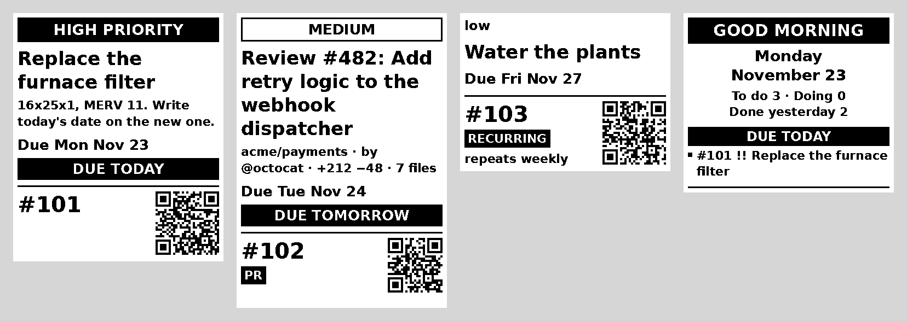
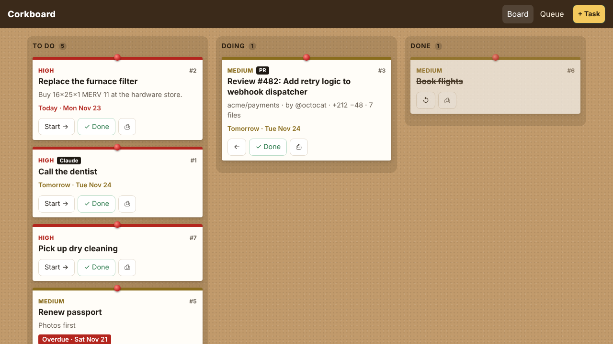

# Corkboard

A physical kanban board. Tasks are printed as cards on a USB thermal receipt
printer and pinned to a corkboard. A Raspberry Pi runs everything:

- a **web app** for creating, editing and moving tasks from a phone or laptop
- a **print queue** that holds jobs while the printer is off and prints them when it's back
- **automations**: print on create, a morning digest, due-soon reminders, recurring tasks, a weekly overdue reprint
- a **Claude custom connector** (remote MCP) to add, list, update, complete and print tasks from a chat
- a **GitHub feed** that prints a card for every pull request waiting on your review, and closes it once you've reviewed





## How it fits together

```
 web UI ─┐
 Claude ─┤                       ┌──────────────┐     ┌──────────────┐
 GitHub ─┼──▶ create_task() ──▶  │ SQLite queue │ ──▶ │ print worker │ ──▶ /dev/usb/lp0
 timers ─┘                       └──────────────┘     └──────────────┘
```

Two systemd services run on the Pi:

| Service | Runs | Command |
|---|---|---|
| `corkboard-web` | Web UI, Claude connector (`/mcp/<secret>`), GitHub webhook (`/github`) | `python -m app` |
| `corkboard-worker` | Print worker with keepalive, scheduler, GitHub poll | `python -m worker.worker` |

Every source calls the same `create_task()`, so the printer only ever gets one job at a time from one
process, and jobs wait in SQLite whenever the printer is off. Cards are rendered at print time, so a
reprint always shows current details.

## Install on the Raspberry Pi

Needs Raspberry Pi OS **Bookworm** or later (Python 3.10+). A Pi 2B is enough.

```bash
git clone https://github.com/Wet-Hands/CorkboardKanban.git ~/corkboard
```

```bash
cd ~/corkboard && ./scripts/install.sh
```

`install.sh` installs system packages, creates `.venv`, writes `.env` with generated secrets, installs
the udev rule and adds you to the `lp` group, then installs and starts both services. It is safe to
run again after `git pull`.

Then:

1. Open `http://<pi-hostname>.local:8000`.
2. In `.env`, set `CORKBOARD_BASE_URL` to that address (card QR codes open it) and check
   `CORKBOARD_TIMEZONE`. Then restart:
   ```bash
   sudo systemctl restart corkboard-web corkboard-worker
   ```
3. Print sample cards to check the printer (stop the worker first so they don't both write to it):
   ```bash
   sudo systemctl stop corkboard-worker && .venv/bin/python scripts/test_print.py --digest; sudo systemctl start corkboard-worker
   ```
   If the cards are garbled or striped, try `--impl bitImageColumn` or `--fragment-height 256`, then
   put the setting that works in `.env` (`PRINTER_IMAGE_IMPL`, `PRINTER_FRAGMENT_HEIGHT`).

Logs:

```bash
journalctl -u corkboard-web -u corkboard-worker -f
```

## The printer

The GEZHI micro-printer identifies as `28e9:0289` and appears as `/dev/usb/lp0` through the Linux
`usblp` driver. Cards are 1-bit images 384 dots wide (58 mm paper), sent with python-escpos.

| Problem | Cause | Fix |
|---|---|---|
| `Permission denied: /dev/usb/lp0` | Device is `root:lp`, mode 660 | `install.sh` installs `deploy/99-h22-printer.rules` (mode 0666) and adds you to `lp`; log out and in |
| `/dev/usb/lp0` missing | Printer is off, so `usblp` removed the node | Switch it on or replug it; queued jobs then print by themselves |
| Disconnects ~86 s after connecting | The printer powers itself off | The worker sends a keepalive (`DLE EOT 1`) every 30 s while idle; external power or another cable also help |

The board shows a banner while the printer is missing, and **Queue** lists every job, with retry for
failed ones. A self-test page (hold FEED while powering on) shows the paper width and may list an
auto-off setting.

The udev rule also creates `/dev/corkboard-printer`. Set `PRINTER_DEVICE=/dev/corkboard-printer` if
you ever have more than one `lp` device.

## Cards

Top to bottom: priority header (HIGH = solid bar, MEDIUM = outlined bar, LOW = plain text), title,
description, due date with a DUE TODAY / DUE TOMORROW / OVERDUE banner, then the task number, a
source tag (PR, CLAUDE, RECURRING) and a QR code. The QR opens the task page, or the pull request
itself for GitHub cards. The web app's preview is the same PNG that gets printed.

## Automations

All times are in `CORKBOARD_TIMEZONE` and set in `.env`.

| What | When (default) | Setting |
|---|---|---|
| Print the card when a task is created | Immediately | `PRINT_ON_CREATE` (the form has a checkbox too) |
| Morning digest: overdue, due today, in progress, high priority | 07:30 daily | `DIGEST_TIME`, `DIGEST_DAYS` |
| Recurring tasks: when a recurring task is done, its next card prints on the next date | 07:30 daily | set per task: daily, weekdays, weekly, monthly |
| Due-soon reminder: reprint high-priority cards due today or tomorrow, once per due date | 16:00 daily | `REMINDER_TIME`, `REMINDER_PRIORITIES` |
| Reprint overdue cards (thermal paper fades) | Monday 07:35 | `OVERDUE_REPRINT_DAY`, `OVERDUE_REPRINT_TIME` |
| GitHub review poll | Every 5 minutes | `GITHUB_POLL_MINUTES` |

If the worker restarts after 07:30, it catches up on that morning's recurring cards, and on the
digest if it's less than two hours late.

## GitHub pull request reviews

**Polling (main method).** Put a token in `GITHUB_TOKEN`: either a fine-grained token with read-only
*Pull requests* access to the repositories you review, or a classic token with `repo`. Every
5 minutes the worker searches `is:open is:pr review-requested:@me`. New PRs get a card; PRs that drop
out of the results (you reviewed, it merged or closed, or the request was removed) have their card
marked done. Works for any repo you can see, with no public endpoint needed.

**Webhooks (optional, instant).** On repos or orgs you admin, add a webhook:

- Payload URL: `https://<public host>/github`, content type `application/json`
- Secret: the value of `GITHUB_WEBHOOK_SECRET` (generate one with `openssl rand -hex 32`)
- Events: *Pull requests* and *Pull request reviews*

Set `GITHUB_USERNAME` too. Signatures (`X-Hub-Signature-256`) are checked and repeated
`X-GitHub-Delivery` IDs are ignored. Poll and webhook share the `seen_github_prs` table, so a PR
never gets two cards.

Review cards are titled `Review #123: <PR title>`, list repo, author, lines and files changed, and are
due one business day after they appear (`GITHUB_DUE_BUSINESS_DAYS`). Priority comes from labels:
`urgent` or `hotfix` = high (`GITHUB_HIGH_LABELS`), drafts = low or skipped (`GITHUB_DRAFT_MODE`),
everything else = medium.

## Claude connector

The connector is an MCP server at `/mcp/<MCP_SECRET>` (the secret is generated by `install.sh`).
Its tools are `create_task`, `list_tasks`, `update_task`, `complete_task`, `print_task` and
`print_daily_digest`.

Claude reaches connectors from Anthropic's servers, so the Pi needs a public HTTPS address. Expose
**only** `/mcp` (and `/github` if you use the webhook); the board stays on your LAN. No router
ports need opening.

**Tailscale Funnel** (free `*.ts.net` address):

```bash
sudo tailscale funnel --bg --set-path /mcp http://127.0.0.1:8000/mcp
```

```bash
sudo tailscale funnel --bg --set-path /github http://127.0.0.1:8000/github
```

**Cloudflare Tunnel** (needs a domain on Cloudflare): copy `deploy/cloudflared-config.yml.example` to
`/etc/cloudflared/config.yml`, fill in your tunnel ID and host name, and run
`sudo cloudflared service install`. Its ingress rule only forwards `/mcp` and `/github`. You can add
Cloudflare Access in front for OAuth.

Put the public host name in `MCP_ALLOWED_HOSTS` (turns on Host-header checks) and restart
`corkboard-web`. Check that the endpoint is reachable; a `400` means the connector answered, and a
`404` means the path or secret is wrong:

```bash
curl -s -o /dev/null -w '%{http_code}\n' -X POST -H 'Content-Type: application/json' -d '{}' https://<public host>/mcp/<MCP_SECRET>
```

Then in Claude, go to **Customize > Connectors > Add > Custom > Web** and enter
`https://<public host>/mcp/<MCP_SECRET>`. Custom connectors are available on paid plans. Set the
print tools to "Always ask" at first. Try: *"Add a high-priority task to call the plumber tomorrow
and print it."*

Treat the full URL like a password: anyone who has it can add tasks and use your paper.

## Security

- `.env` holds every secret, is `chmod 600` and is git-ignored. Give the GitHub token the narrowest
  scopes that work.
- The web UI has no login by default, since it's meant for your LAN. If it's reachable from
  anywhere else, set `CORKBOARD_WEB_USERNAME` and `CORKBOARD_WEB_PASSWORD` (HTTP basic auth). Forms
  carry a CSRF token.
- `/mcp/<secret>` is protected by its random path (plus Host checks with `MCP_ALLOWED_HOSTS`, plus
  Cloudflare Access if you add it). `/github` only accepts HMAC-signed requests and is off unless
  `GITHUB_WEBHOOK_SECRET` is set.

## Backups

SD cards can corrupt on power loss, so back up the database now and then (it's safe while running):

```bash
sqlite3 ~/corkboard/data/corkboard.db ".backup $HOME/corkboard-$(date +%F).db"
```

## Developing on a laptop

```bash
python3 -m venv .venv && .venv/bin/pip install -r requirements-dev.txt
```

```bash
cp .env.example .env
```

In `.env`, set `PRINTER_DEVICE=dry-run` (cards are saved as PNGs in `data/printed/`) and
`CORKBOARD_BASE_URL=http://localhost:8000`. Then run each of these in its own terminal:

```bash
.venv/bin/python -m app
```

```bash
.venv/bin/python -m worker.worker
```

Run the tests:

```bash
.venv/bin/python -m pytest
```

`scripts/test_print.py --save out/` renders the sample cards without a printer.

## Files

| Path | Purpose |
|---|---|
| `config.py` | Loads `.env`: device, paper width, timezone, schedules, GitHub rules |
| `app/__init__.py`, `app/__main__.py` | Flask app factory; `python -m app` serves Flask and MCP together with uvicorn |
| `app/db.py` | SQLite connection and tables: `tasks`, `print_jobs`, `seen_github_prs`, `github_deliveries` |
| `app/models.py` | Task and queue functions; the single `create_task()` every source uses |
| `app/web.py`, `templates/`, `static/style.css` | Board, task form with live card preview, task page (what the QR opens), print queue |
| `app/render.py` | Pillow renderer for cards and the digest, with QR codes, as 1-bit images |
| `app/printer.py` | Writes to `/dev/usb/lp0`, waits while the printer is off, keepalive, dry-run |
| `app/mcp_server.py` | Claude connector tools and the combined ASGI app |
| `app/github.py` | Shared PR-to-card logic for the poll and the webhook |
| `app/github_webhook.py` | `/github` endpoint with signature check |
| `worker/worker.py` | Print-queue loop with retries and backoff; starts the scheduler |
| `worker/scheduler.py` | Digest, recurring, due-soon and overdue automations |
| `worker/github_poll.py` | Review-request poll |
| `scripts/install.sh` | One-shot Pi setup |
| `scripts/test_print.py` | Prints (or saves) a sample card of each priority |
| `deploy/` | udev rule, systemd units, Cloudflare Tunnel config template |
| `fonts/` | DejaVu Sans and DejaVu Sans Bold (Bitstream Vera license, see `fonts/LICENSE`) |
| `tests/` | pytest suite |
